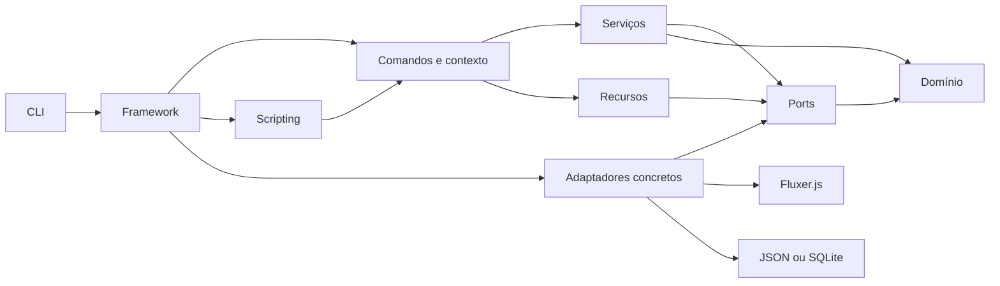

# Arquitetura

O Yuzuha é uma biblioteca executada dentro do processo do bot. O núcleo coordena
mensagens e serviços; o function mode é um adaptador opcional carregado sob
demanda. Não há servidor HTTP próprio nem serviço remoto do Yuzuha.

## Mapa dos módulos

```text
src/
  domain/                  Tipos e regras de valores, mensagens, moderação e estado
  ports/                   Contratos Store, Transport, recursos nativos e acesso ao SDK
    resources/             Contratos por área: usuários, cargos, canais, mensagens...
  services/                Autorização, moderação, casos, variáveis, scheduler, HTTP e música
  commands/                Definição, builders, argumentos tipados e contexto
  scripting/               AST, parser, registro, avaliação, runtime e limites
    builtins/              Funções por categoria
  framework/               Bot, eventos, registro, carga, roteamento, limites e middleware
  infrastructure/
    fluxer/                Mensagens, payloads, transporte e recursos do SDK real
    storage/               Estado, fila, caminhos, memória, JSON e SQLite
    lavalink/              REST/WebSocket v4, limites, cache e validação de protocolo
  cli/                     Argumentos, config, scaffold, execução e watcher
  shared/                  Classes de erro
  index.ts                 API pública nativa (yuzuha)
  functions.ts             API pública do function mode (yuzuha/functions)
  sdk.ts                   Reexportação do SDK (yuzuha/sdk)
  testing.ts               Transporte, mensagens e recursos de teste (yuzuha/testing)
  tooling.ts               Auxiliares de editor, diagnósticos e catálogos (yuzuha/tooling)
  music.ts                 Lavalink, filas e ponte para voz nativa (yuzuha/music)
  tooling/                 Análise textual para editores, sem execução de funções
```

Os arquivos da raiz, como `bot.ts`, `context.ts`, `runtime.ts`, `store.ts` e
`adapter.ts`, mantêm reexports para os módulos atuais. Os consumidores importam
pelos seis exports públicos do pacote; `runtime.ts` e `parser.ts` não fazem
parte da raiz nativa.

## Responsabilidades e dependências

| Área | Responsabilidade | Não deve concentrar |
|---|---|---|
| `domain` | Dados e regras puras, permissões e conversões | Rede, filesystem, CLI |
| `ports` | Interfaces exigidas pelos serviços | Implementações de SDK ou disco |
| `services` | Autorização, ação de moderação e persistência de casos | Parser, watcher ou detalhes de Fluxer.js |
| `commands` | Descrição, conversão de argumentos e fachada de contexto | Transações ou hierarquia implementadas novamente |
| `scripting` | Compilar e executar a linguagem | Instanciar client ou escolher store |
| `framework` | Compor runtime, registro, despacho e ciclo de vida | Implementar operações REST |
| `infrastructure` | Traduzir contratos para SDK e disco | Escolher comandos do produto |
| `cli` | Configuração, geração e processo de desenvolvimento | Duplicar regras de moderação |

`AuthorizationService` consulta membros e verifica permissões e hierarquia.
`ModerationService` valida a ação, chama o transporte e pede o registro do caso.
`CaseService` numera e consulta casos. `VariableService` resolve os escopos e
usa o store. `CommandContext` expõe essas operações com a API conhecida por
comandos nativos e funções de script.
`NativeModeration` e `ScopedData` oferecem `ctx.mod` e `ctx.data` sobre esses
mesmos serviços; não duplicam autorização nem persistência. O contrato
`NativeAccess` usa tipos do SDK para expor client e mensagem original ao contexto.

`Resources` separa as operações nativas usadas por scripts e comandos. Os
contratos ficam em `ports/resources/`, a implementação Fluxer em
`infrastructure/fluxer/resources/` e os serviços transversais (scheduler e HTTP)
em `services/`. `FluxerResources` compõe as áreas e é injetado em
`CommandContext.resources` através de `bindAuthorizedResources`. Esse serviço
verifica autor/bot, servidor, permissões locais e hierarquia nas mutações de
cargos, canais e webhooks. O acesso explícito a `bot.resources` preserva o port
direto. `mockResources` substitui fatias nos testes; os guards continuam ativos.

`StateMaintenance` opera estatísticas, limpeza de TTL, backups e restauração
sobre `Store`, sem duplicar regras em cada backend. A restauração valida o
snapshot e o resultado antes de confirmar a transação. Cron é uma regra pura em
`domain/cron.ts`; o scheduler coordena claims, heartbeat, workers e políticas de
retry. `HttpService.withPolicy` restringe a política do serviço pai antes de
vincular o sinal do contexto.

`MusicManager` e `MusicPlayer` coordenam filas e controles sobre `MusicBackend`.
O gerenciador distribui carga e limita a recuperação por node; o player serializa
controles, correlaciona eventos e confirma alterações de fila apenas na sessão
que iniciou o pedido. `LavalinkNode` traduz esse port para REST, eventos e ciclo
de sessão v4. Compartilhamento de buscas usa uma espera cancelável por chamada e
uma requisição por identificador em andamento. `FluxerVoice` implementa
`NativeVoice` usando o SDK opcional, carregado apenas ao entrar em voz.
`MusicAudioOutput` separa publicação de áudio das credenciais de voz do protocolo
Lavalink. `FluxerLavalinkBridge` implementa esse port, ligando um `MusicAudioStream`
incremental ao SDK de voz. O plugin Java em `bridges/lavalink/` extrai Opus pela
API pública do servidor; o núcleo TypeScript não depende de classes Java. O núcleo
recebe essas capacidades por injeção; importar `yuzuha` não carrega o cliente de
música, `ws` por essa integração ou o pacote de voz. Consulte [MUSIC.md](MUSIC.md).



As setas representam dependências de código. Em execução, os serviços chamam
objetos fornecidos pelas interfaces `Store` e `Transport`. Por isso, testes usam
`MockTransport` e `MemoryStore` sem substituir regras do núcleo.

`npm run check:architecture` acompanha imports e reexports locais, inclusive
caminhos que passam pelos arquivos de compatibilidade. Ele restringe domínio,
ports, serviços e scripting às camadas permitidas. Não verifica a correção do
comportamento nem o conteúdo de dependências externas; isso depende dos testes.

## Percurso de uma mensagem

1. `FluxerTransport` normaliza a mensagem recebida pelo listener do SDK.
2. O bot descarta mensagens de bots, resolve prefixo e nome e deduplica o ID.
3. O registro entrega o comando já validado e, quando houver, a AST compilada.
4. O contexto prepara servidor, permissões, argumentos e cooldown.
5. Checks validam condições adicionais; middlewares globais e locais recebem `ctx` e `next`.
6. O comando executa `run(ctx)` ou a AST por meio do avaliador.
7. Scripts e JS/TS chamam os mesmos serviços para moderação e estado.
8. O framework responde a guards/erros e chama os hooks de resultado.

Bots, prefixos alheios e comandos ausentes retornam `ignored`. Um guard recusado
retorna `guarded`; falhas operacionais retornam `error`; execução concluída retorna
`success`. Esses resultados não garantem que não houve efeito parcial:
uma API pode confirmar uma ação antes de o disco falhar.

## Percurso de um evento de script

`scriptEvent` valida e compila a definição antes de instalar um listener em
`NativeEvents`. `adaptScriptEvent` converte um dos seis payloads do SDK em
metadados explícitos; `EventContext` preserva ausências como `null` e só oferece
helpers de mensagem quando há uma mensagem completa. A autorização usa o usuário
do evento ou `actorID` configurado, sem assumir a autoridade do bot. A execução
recebe sinal, correlação e o mesmo runtime de comandos; shutdown aguarda os
handlers rastreados. O contrato está em [EVENTS.md](EVENTS.md).

## Compilação e avaliação

O parser gera uma AST com offsets e origem. O registro verifica se cada função
existe e aceita a quantidade de argumentos. O avaliador mantém orçamento e
memoiza argumentos por chamada. As funções escolhem quais argumentos avaliar,
permitindo `$if`, `$and`, `$or` e `$try` sem executar ramos descartados.

As funções são agrupadas em `context`, `flow`, `guards`, `values`, `messages`,
`embeds`, `moderation`, `storage`, `users`, `roles`, `channels`, `collectors`,
`webhooks`, `expressions`, `threads`, `invites`, `language`, `schedule` e
`network` e `events`. Metadados de uso, aridade e descrição alimentam
a CLI e a [referência gerada](FUNCTIONS.md), evitando assinaturas duplicadas.

## Registro e recarga

Cada operação monta um conjunto candidato e só troca o registro depois de
carregar e validar todos os comandos. Colisões de nomes e aliases invalidam
a operação inteira. Imports JS/TS podem produzir efeitos por conta própria;
a troca atômica protege o registro, não desfaz efeitos externos do módulo.

- `command` registra um comando manual.
- `load(dir)` substitui todo o conjunto de comandos carregados.
- `load(dir, false)` acrescenta um diretório.
- `reload(dir)` troca somente os comandos originados desse diretório.

O registro mantém a origem por diretório resolvido. O watcher usa `reload` para
preservar comandos de `setup` e de outras pastas. Ao compilar o primeiro comando
com `code`, o framework registra os builtins; bots nativos permanecem sem parser
e sem as 288 funções.
Plugins preparam funções em um runtime candidato antes de compilar seus comandos,
validam eventos nativos e compilam `scriptEvents` antes de aplicar o lote aos
registros ativos. Comandos com `code` e eventos de script ativam os builtins
antes da compilação; funções do próprio plugin já estão no runtime candidato.

## Persistência e encerramento

Stores validam o estado resultante e clonam o retorno do callback antes de
confirmar uma transação. Falha nessa preparação não grava dados. JSON usa fila
por instância e substituição de arquivo; SQLite usa transações entre conexões.

`destroy` retira os listeners próprios, impede novos despachos, aborta os sinais
cooperativos de comandos/eventos e espera os handlers ativos,
encerra o client e fecha o store criado pelo próprio bot. Stores injetados
continuam pertencendo ao chamador. A CLI encerra também o store da config.
Chamadas externas repetidas aguardam a mesma operação. Uma chamada de dentro
do próprio comando, middleware ou hook apenas solicita a parada e retorna,
permitindo que o handler termine sem esperar por si mesmo. O login pendente
recebe cancelamento.

`NativeEvents` associa callbacks tipados do SDK às inscrições do framework.
`on/once/off` e `defineEvent` compartilham esse registro. Handlers assíncronos são
rastreados para drenagem e suas falhas seguem para `onError`; callbacks instalados
diretamente no client permanecem sob responsabilidade do consumidor.

Leia [STORAGE.md](STORAGE.md) para estado, falhas parciais e prazo cooperativo;
[SCHEDULER.md](SCHEDULER.md) para cron e concorrência e [HTTP.md](HTTP.md) para
streaming, multipart e políticas por comando. O runtime não isola plugins JS/TS em outro processo.

## Onde implementar uma mudança

| Mudança | Ponto de partida |
|---|---|
| Nova função de script | `src/scripting/builtins/` e referência gerada |
| Alterar semântica da linguagem | Parser/avaliador e testes de runtime |
| Regra de moderação ou autorização | `src/services/` e regras puras em `domain/` |
| Converter argumento | `src/commands/arguments.ts` |
| Schema e inferência de argumentos | `src/commands/builders.ts` e `typed-arguments.ts` |
| Eventos nativos e ciclo de vida | `src/framework/events.ts` e `bot.ts` |
| Eventos de script | `src/framework/script-events.ts`, `commands/event-context.ts` e `domain/events.ts` |
| Manutenção e restauração de estado | `src/services/state-maintenance.ts` |
| Novo mecanismo de persistência | Implementar `Store` em `infrastructure/storage/` |
| Novo recurso nativo | Contrato em `ports/resources/`, implementação em `infrastructure/fluxer/resources/` |
| Agendamento ou HTTP | `src/services/scheduler.ts` e `src/services/http.ts` |
| Detalhe do SDK | `src/infrastructure/fluxer/` |
| Recarga, aliases ou despacho | `src/framework/` |
| Nova opção de terminal | `src/cli/arguments.ts` e ação correspondente |

Mantenha a API pública documentada em [API.md](API.md), acrescente teste do
comportamento afetado e execute as [verificações](TESTING.md).
